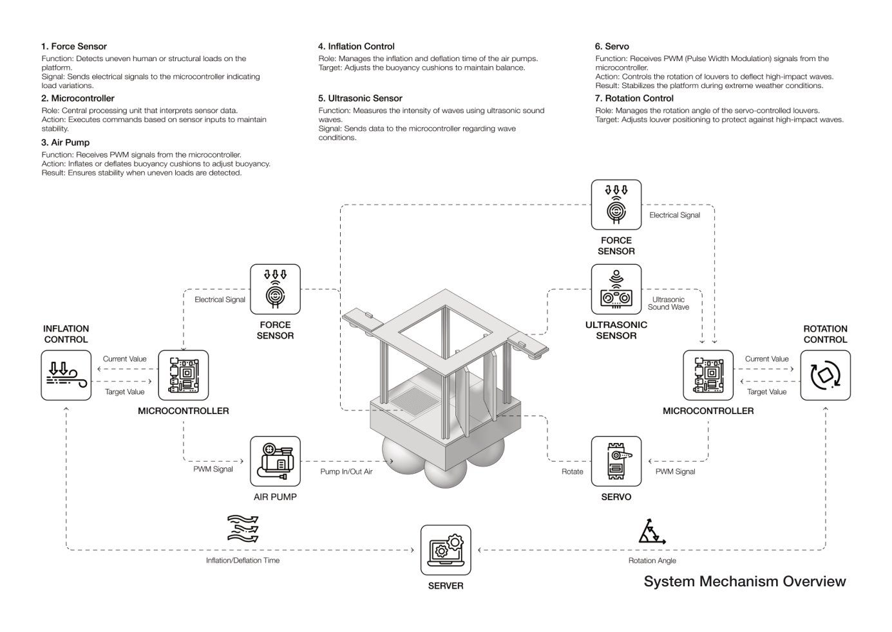
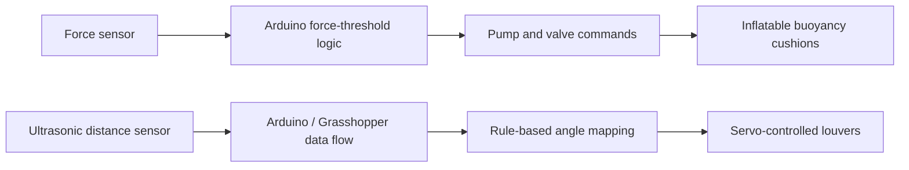
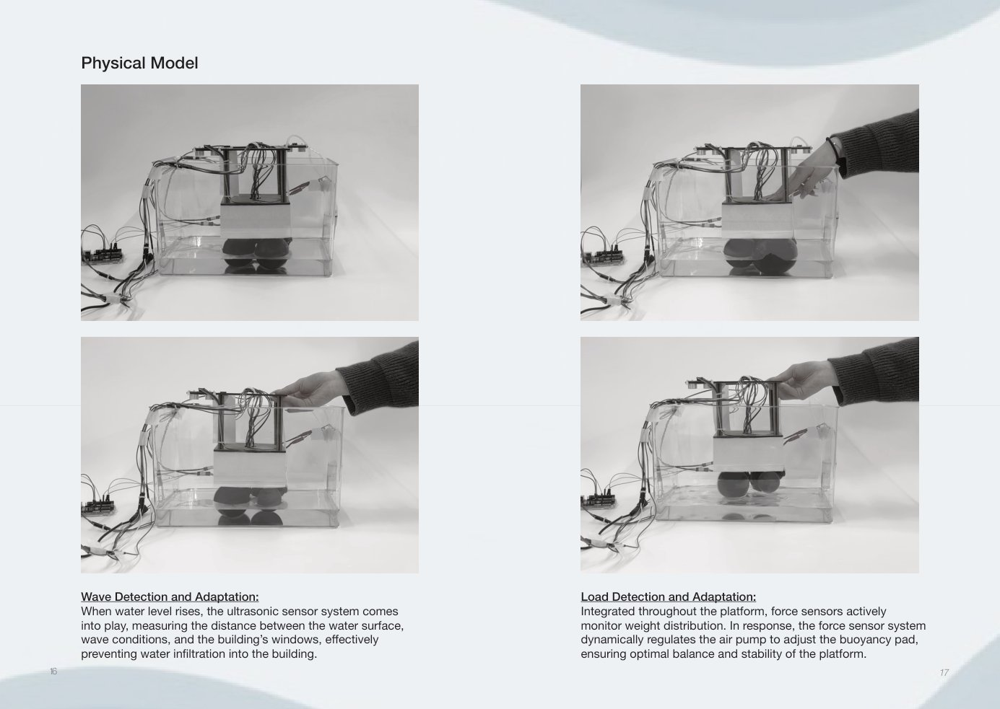
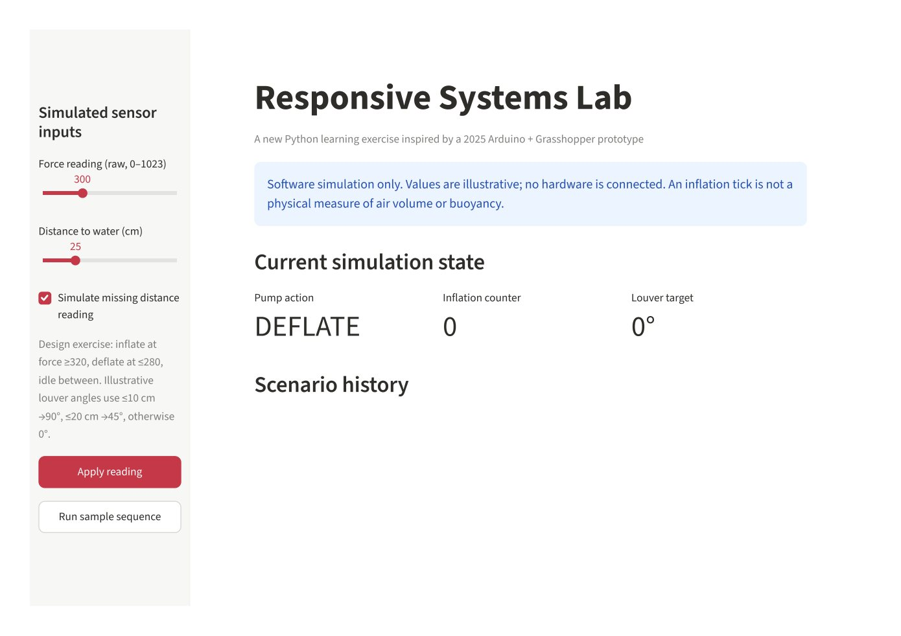

# Adaptive Modular Platforms for Climate-Resilient Urbanism

**A responsive-architecture prototype connecting human needs, sensors, software and physical actuation.**  
**The University of Hong Kong · 2025 · Arduino · Rhino/Grasshopper · Python**

**Recognition:** Merit Prize, 2025 Hong Kong University Student Innovation and Entrepreneurship Competition.

**Competition submission:** 11th edition · Innovation A · Entry **EC-042**.  
**Project team:** **Yang Yiru** (team leader) and **Zhou Yiheng**.  
**Instructor:** **Professor Kaicong Wu**.


## The problem: climate resilience in Tai O

The project began with a design question: **How might existing coastal communities adapt to changing water levels and human loads without abandoning their local architectural identity?**

The original competition submission focuses on **Tai O, Hong Kong**, particularly its historic stilt houses (*Pang O*). It explores modular floating infrastructure as a conceptual response to rising sea levels, extreme weather, and the competing goals of heritage preservation and community use. The concept also considers potential uses for fishing activities and shared waterfront spaces.

The project is a **student research-and-design prototype**, not a deployed or certified flood-protection system. The potential community applications described in the competition booklet are **proposals**, not field-tested outcomes.

## What we built and demonstrated (2025)

We designed a modular floating-platform concept and built a working tabletop prototype demonstrating **two responsive subsystems**:

| Subsystem | Inputs | Control response | Physical output |
|---|---|---|---|
| **Load adaptation** | Force-sensitive sensor readings | Arduino threshold and pump/valve-control logic | Air-pump operation adjusts inflation of buoyancy cushions |
| **Wave / water-level adaptation** | Ultrasonic distance readings | Arduino–Grasshopper data exchange and parameter-based angle mapping | Servos move kinetic façade / louver elements |

The physical prototype successfully demonstrated both interactions according to the project team and its photographic documentation. **This does not establish the prototype's performance under real coastal conditions.**

### System architecture



*Original system-mechanism diagram from the team's competition submission (PDF page 7, printed pp. 12–13). It depicts the conceptual system architecture rather than independently validating every physical connection.*



### Physical demonstration



*Demonstration photographs from the team's competition submission (PDF page 9, printed pp. 16–17). The images show the prototype, not a commercial-scale installation.*

## Implementation and code archive

The historical project combines **Arduino C++**, **Rhino/Grasshopper**, and embedded **Python 3** scripts. Examples of the work visible in the surviving files include reading force-sensitive analogue values, applying conditional control rules, tracking command states, exchanging data through a serial connection, and mapping parameters to servo-angle commands.

| Location | What to find | Notes |
|---|---|---|
| [`arduino/force-control/`](arduino/force-control/) | Force-responsive pneumatic-control sketches, including v2, v4 and VVS variant | Archived, project-specific sketches; not retested against hardware for this upload |
| [`arduino/experiments/`](arduino/experiments/) | Earlier timed pump-control experiment | Development history |
| [`grasshopper/0902_Arduino.gh`](grasshopper/0902_Arduino.gh) | Original visual Grasshopper definition | Requires Rhino/Grasshopper to inspect visually |
| [`grasshopper/extracted-scripts/`](grasshopper/extracted-scripts/) | Six readable Python scripts extracted from Grasshopper components | Archived components; not a standalone executable |
| [`media/grasshopper/`](media/grasshopper/) | Screenshots of serial port, sensor input, parameter processing, and output blocks | Captured with no live serial connection |
| [`docs/`](docs/) | Technical analysis, reproducibility notes and attribution | Explains the limits of the preserved code |

The project's original architecture is **rule-based rather than machine-learning-based**. The surviving files do not fully establish the exact final firmware-to-louver connection, even though the team reports successful physical operation. See [technical architecture](docs/SYSTEM_ARCHITECTURE.md), [code notes](docs/CODE_NOTES.md), and [reproducibility limits](docs/REPRODUCIBILITY.md).

## Responsive Systems Lab — new Python learning extension (2026)

After the original architecture project, a **separate, software-only simulator** was developed as a Python learning exercise. It explores explainable control decisions, simulated sensor input, a force deadband, louver-angle mapping, and a small automated test suite. **It does not communicate with the original hardware or recreate measured physical behavior.**



*Screenshot supplied from the Streamlit-based simulator in November 2026. The displayed readings are illustrative, not measurements from the 2025 physical prototype.*

[Explore the simulator and instructions](python-extension/README.md) · [Read the software-extension notes](docs/PYTHON_EXTENSION.md)

```bash
cd python-extension
python -m simulator.run_demo
python -m unittest discover -s tests -v
# For the optional interactive UI:
python -m pip install -r requirements.txt
streamlit run app.py
```

The 2026 extension was prepared with **AI coding assistance**. Personal code review and further independently understood changes should be completed before describing it as independently authored software.

## Contribution, mentorship and attribution

- **Yang Yiru — Team Leader / Project Contributor:** Led the architectural and system design, contributed Arduino programming and project-specific Grasshopper parameter-control workflows, participated in physical prototyping, and coordinated the project team.
- **Zhou Yiheng — Project Teammate / Co-developer:** Collaborated on the project and is credited as a group member in the official competition submission.
- **Professor Kaicong Wu — Project Instructor:** Provided academic guidance and supervision.

The project used professor-provided Arduino communication frameworks and AI-assisted Python scripts for portions of the Grasshopper serial communication workflow. These dependencies and tools are acknowledged in the technical documentation.

See [full attribution and publishing notes](docs/ATTRIBUTION.md).

## Competition documentation and next steps

The original entry was submitted to the **11th Hong Kong University Student Innovation and Entrepreneurship Competition**, **Innovation A**, project **EC-042**. The submission includes the Tai O problem statement, modular platform proposal, diagrams, physical demonstration photos, and proposed longer-term uses such as stilt-house retrofits, fishing infrastructure, community spaces, urban farming, and temporary housing. Those expanded uses remained **future concepts** in this project.

**Project status:** 2025 tabletop prototype completed; no independent field validation, long-term reliability evaluation or safety certification is claimed. The 2026 Python simulator is a separate study exercise. There is no repository-wide open-source license because the archive contains collaborative work and mixed-provenance components.
