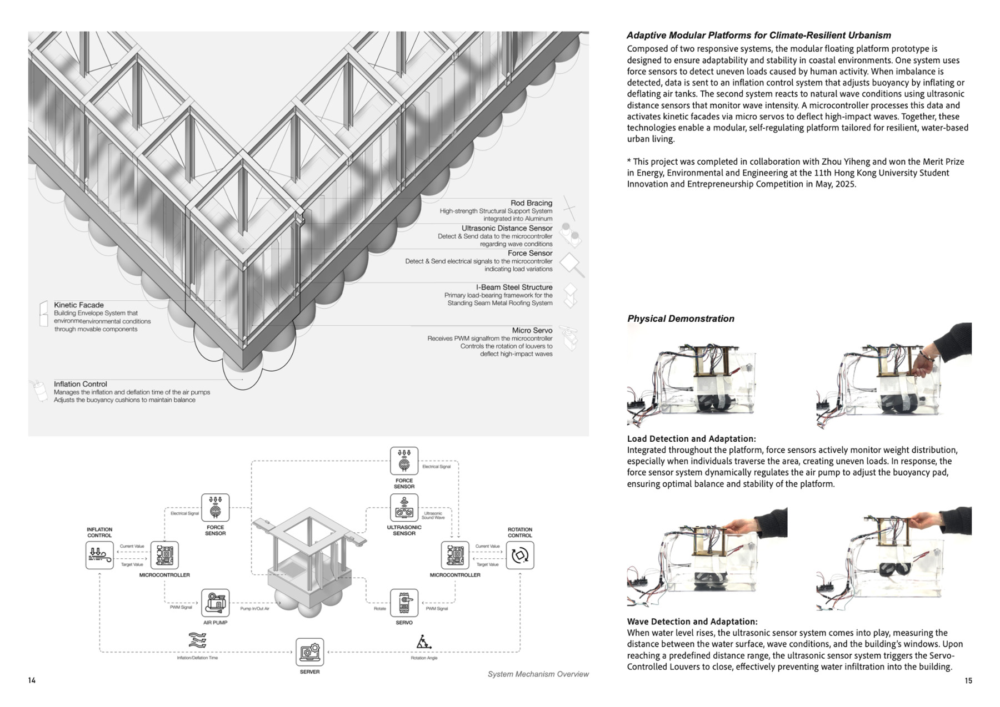
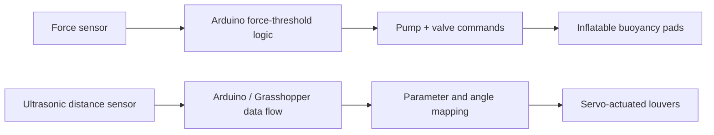

# Adaptive Modular Platforms for Climate-Resilient Urbanism

**Responsive architecture · Physical computing · Arduino · Rhino/Grasshopper · Python**  
**HKU BA(Architectural Studies) final-year project (2025) | Merit Prize, Hong Kong University Student Innovation and Entrepreneurship Competition 2025**

## Overview

This collaborative project investigates how a modular floating platform can respond to changes in human loads and water conditions. Two responsive subsystems were developed and demonstrated in a physical prototype:

1. **Load adaptation:** force sensor readings inform pump/valve commands to change the inflation of buoyancy elements.
2. **Wave-responsive façade:** ultrasonic distance sensing informs a servo-actuated kinetic louver response to rising water levels / wave conditions.

The team reports that both systems operated in the physical prototype. The surviving files establish substantial elements of the control logic and Grasshopper communication workflow; **the exact source-code connection from distance readings to façade actuation has not been fully reconstructed from the archived files**. This repository documents both the demonstrated prototype and the limits of the surviving technical evidence.

## System at a glance

This is a **system-level diagram**, not a verified record of every final wire, pin and firmware version.

## Technical material in this repository

| Folder | Contents | Evidence status |
|---|---|---|
| [`arduino/force-control/`](arduino/force-control/) | Original Arduino sketches for force-responsive pneumatic behavior, including v2, v4 and an alternate VVS variant | Project-specific logic visible; not hardware-tested for this release |
| [`arduino/experiments/`](arduino/experiments/) | Earlier timed inflation/deflation experiment | Archived development sketch |
| [`grasshopper/0902_Arduino.gh`](grasshopper/0902_Arduino.gh) | Original Grasshopper definition | Archived binary definition; requires Rhino/Grasshopper to open |
| [`grasshopper/extracted-scripts/`](grasshopper/extracted-scripts/) | Six *unchanged* Python scripts extracted from embedded GH components | For code review; these are not a standalone app |
| [`media/`](media/) | Original project board and screenshots of the Grasshopper canvas | Captured outside a live serial session; panels show disconnected-state messages |
| [`docs/`](docs/) | Architecture, code notes, provenance and reproduction limitations | Research/portfolio documentation |

## What the code demonstrates

- Reading an analogue force-sensitive resistor value with `analogRead(A0)`.
- Applying a threshold rule (`fsr > 300`) to choose inflation, idle, or deflation commands.
- Using functions, conditional logic and state counters to manage actuator commands in Arduino sketches.
- Using Grasshopper/Python components to **open a serial port, read incoming data, format commands and send values to Arduino**.
- Mapping sensor-related parameters to two-state (0°/90°) or three-state (0°/45°/90°) outputs in the Grasshopper definition.

These are **rule-based control techniques**, not a machine-learning model. The scripts and hardware setup have not been re-run as part of preparing this archive.

## Evidence and demonstrations

- **Physical prototype:** visible in the [project board](media/project-board.jpg), including force/load and wave-condition demonstrations.
- **Grasshopper setup:** [port](media/grasshopper/01-port-setup.jpg) · [sensor read](media/grasshopper/02-sensor-reading.jpg) · [processing](media/grasshopper/03-sensor-processing.jpg) · [command output](media/grasshopper/04-actuator-output.jpg).
- **Technical interpretation:** [system architecture](docs/SYSTEM_ARCHITECTURE.md) and [code review](docs/CODE_NOTES.md).

## My contribution and collaboration

This was a **collaborative** architectural design and prototyping project. The project lead reports contributing to the architectural/system design, Arduino programming, parameter-control workflows, prototype development and team coordination. Specific authorship of individual GH components and inherited starter code should be distinguished from original project logic. The serial-port interface scripts are marked in the Grasshopper definition as generated using **ChatGPT-4o**.

The group used a **professor-provided Arduino/Grasshopper environment and starter templates**. The original Firefly Firmata code is attributed to Andrew Payne and Jason Kelly Johnson (2015) and includes an 'All Rights Reserved' notice. Those original or derivative teaching-framework files are **not distributed in this public-upload package** pending permission. See [provenance and attribution](docs/ATTRIBUTION.md).

## Reproducing or extending the project

**This repository is a historical project archive, not plug-and-play firmware.** Hardware wiring, a compatible Arduino board, Rhino/Grasshopper, the right serial-port settings and the relevant course framework may be required. The `.gh` file includes a machine-specific serial path that must be changed for another computer. See [reproduction and limitations](docs/REPRODUCIBILITY.md).

Potential future extensions: sensor calibration; noise filtering and hysteresis; measured pressure/water-level feedback; serial-protocol tests; and a software-only simulation for automated regression testing. These are **future improvements, not completed features**.

## Project context and credits

Completed at **The University of Hong Kong** in 2025. The original project was developed with a teammate and received a **Merit Prize** in the university student innovation and entrepreneurship competition. The architecture/prototype images are from the team's project documentation. See [attribution and publication review](docs/ATTRIBUTION.md).

> **Before making this repository public:** confirm any teammates' approval for collaborative materials and review the permissions of any course-provided code. No open-source license has been assigned to this mixed-provenance archive.
