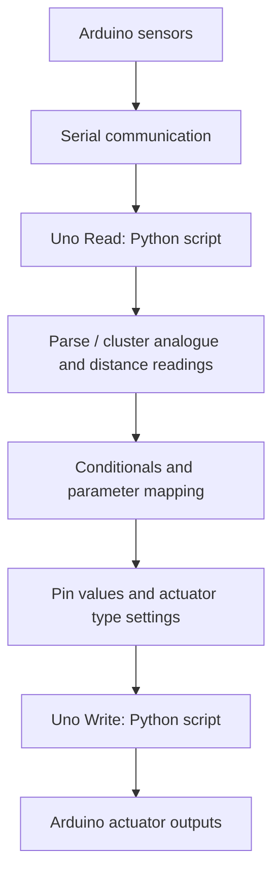

# Responsive system architecture

## Purpose

The project explores how a floating modular platform can respond to both **occupant loading** and **wave/water-level changes**. The two interactions were demonstrated physically (as reported by the project lead and shown in the project board). The diagram below is a conceptual reconstruction based on that documentation and the surviving code.

## Subsystem A — load-responsive pneumatic elements

1. A force-sensitive sensor supplies an analogue input.
2. The Arduino force-control sketches sample `A0` and evaluate readings against a hard-coded threshold of `300`.
3. A `pump(cmd, tDelay)` helper changes outputs associated with pump and valve states. The version-4 sketch also tracks counts in `timer` and `amount` variables.
4. The physical prototype uses pneumatic inflation/deflation to respond to load variation.

The archived sketches are **not** proof of pressure sensing, PID feedback, closed-loop balance measurement, or calibrated load conversion. The code calls `Servo.write()` for channels used as on/off-style electronic control; the naming of `Servo` objects should not be interpreted as physically measuring a servo angle.

## Subsystem B — wave-responsive kinetic façade

1. The prototype includes an ultrasonic distance sensor used to respond to water-surface conditions.
2. A modified Firefly-style teaching framework supports serial data transmission to Grasshopper; archived `.gh` screens show a `Distance (cm)` input path.
3. A Grasshopper Python component contains three-state mapping that returns `0`, `45`, or `90` for certain integer input ranges.
4. The definition also includes a general-purpose Arduino pin-command formatter and a serial-writing component.
5. The team reports that ultrasonic sensing triggered the kinetic façade in the demonstrated prototype.

**Unverified archival connection:** the screenshots do not establish the exact wired path from the distance-angle component to the final servo output, nor which precise firmware file was used during the final demonstration. Avoid claiming this specific code path has been tested recently.

## Rhino/Grasshopper workflow

The Grasshopper definition also provides manual controls and panels to observe values and actuator settings. During the supplied screenshots the serial port was not open, so data panels did not capture live measurements.

## Primary evidence

- [Project board / demonstration photographs](../media/project-board.jpg)
- [Grasshopper sensor reading screenshot](../media/grasshopper/02-sensor-reading.jpg)
- [Grasshopper parameter mapping screenshot](../media/grasshopper/03-sensor-processing.jpg)
- [Grasshopper actuator-command screenshot](../media/grasshopper/04-actuator-output.jpg)
- [Force-control v4 source](../arduino/force-control/20250211_Force_v4.ino)
- [Original Grasshopper definition](../grasshopper/0902_Arduino.gh)
